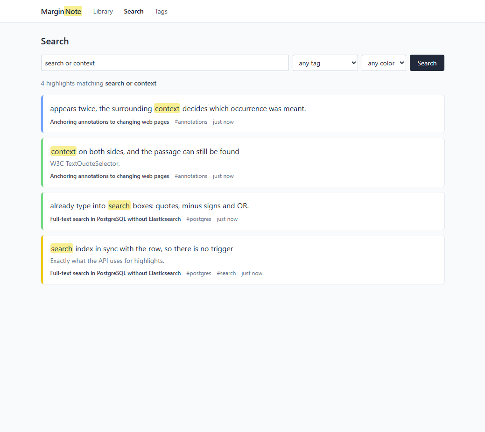
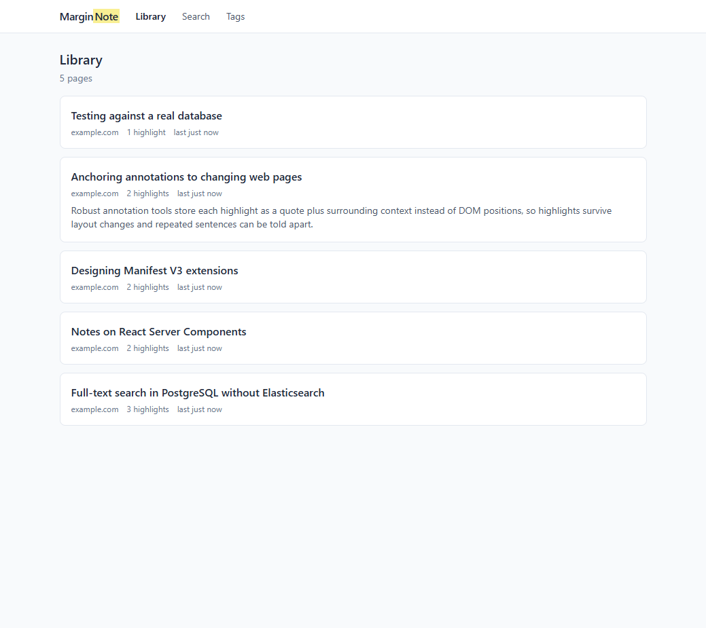
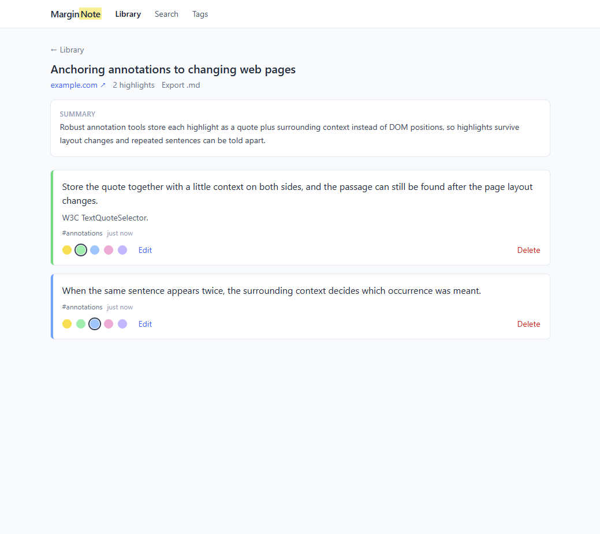
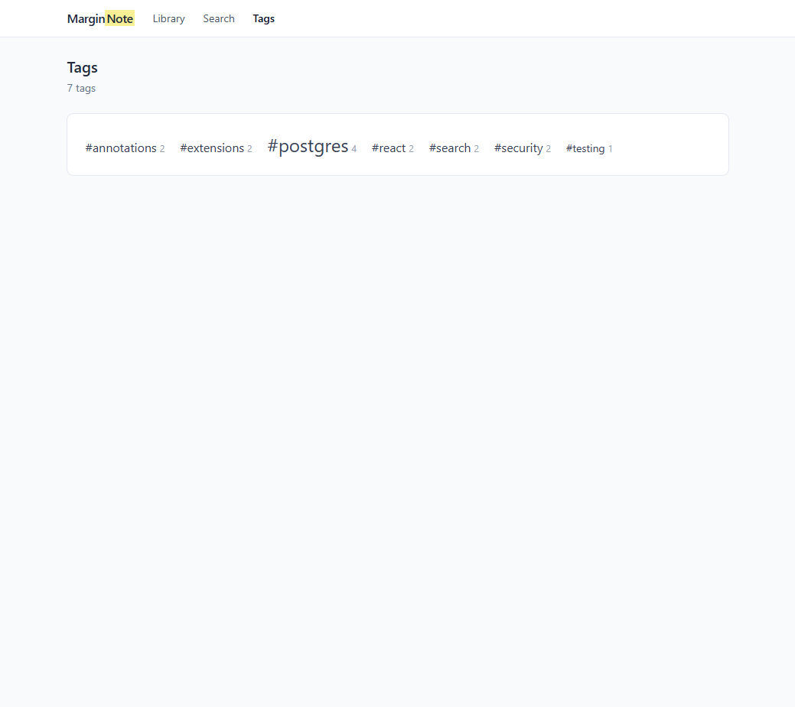
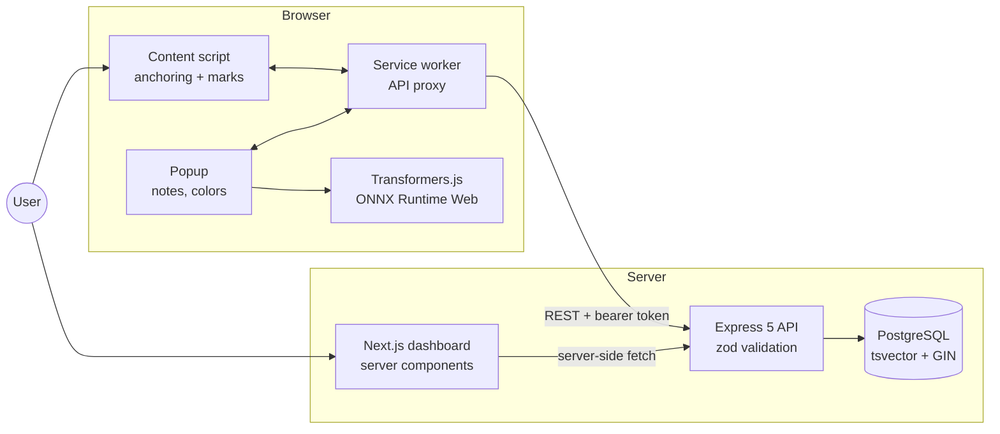

# MarginNote

[](https://github.com/Huypham310/marginnote/actions/workflows/ci.yml)

Highlight text and write notes on any web page, see them again when you come back, search everything later, and get a quick summary of a page from a small model that runs inside the browser. No paid APIs, no page content sent anywhere for the AI part.



## Highlights

- **Chrome extension (Manifest V3)**: highlight with a floating button, the context menu or Alt+Shift+H; notes and 5 colors from the popup (tags are edited in the dashboard)
- **Highlights survive page changes**: each one is stored as a W3C-style text-quote anchor (the quote plus 32 characters of context on each side) instead of DOM positions, so it is found and repainted on the next visit, even when the sentence appears twice or the selection spans several elements
- **On-device summaries**: Transformers.js runs a quantized t5-small (~75 MB) or DistilBART (~270 MB) model in the browser through ONNX Runtime Web; only the weights are downloaded, once
- **Full-text search** in PostgreSQL: generated, weighted `tsvector` column (highlight text > note > tags) with a GIN index, web-search syntax (`"exact phrase"`, `-word`, `or`), matched words marked in the results
- **Dashboard** (Next.js 16): library, page view with inline editing and Markdown export, search, tag cloud; every API call runs on the server so the token never reaches the browser
- **175+ tests** (Vitest, Supertest against a real PostgreSQL), Docker Compose for the full stack, GitHub Actions CI in 4 parallel jobs

## Screenshots

| Library | Page view |
| --- | --- |
|  |  |
| **Search** | **Tags** |
|  |  |

## Architecture



- The **content script** never calls the API itself: it runs with the page's origin, so CORS would block it. All API traffic goes through the **service worker**.
- The **summarizer** runs in the popup, never in the page, and only when the user asks for it. Once the page has at least one highlight, the summary is saved on its page record and shows up in the dashboard and the Markdown export.
- The **dashboard** reads the API from server components and writes through server actions, so `API_TOKEN` stays on the server.

## Quick start

```bash
git clone https://github.com/Huypham310/marginnote && cd marginnote
docker compose up --build            # PostgreSQL + API (:4000) + dashboard (:3000)
npm install && npm run build -w extension
```

Then open `chrome://extensions`, enable Developer mode, **Load unpacked**, and pick `extension/dist`. The extension talks to `http://localhost:4000` by default; change it (and the token) on the options page.

Optional: set `API_TOKEN` before `docker compose up` to require `Authorization: Bearer <token>` on every route except `/health`; the dashboard container gets the same token.

## Repository layout

```
api/          Express 5 + TypeScript API, SQL migrations, Faker seed
extension/    Chrome MV3 extension: content script, service worker, popup, options (React + Vite)
dashboard/    Next.js 16 app (App Router, Cache Components, Tailwind CSS)
docs/         screenshots
.github/      CI workflow
```

## API

Express 5 + TypeScript, request validation with zod, migrations run on startup.

| Method | Path | Description |
| --- | --- | --- |
| GET | `/health` | Database status (never needs a token) |
| POST | `/highlights` | Save a highlight; creates the page from its URL if needed |
| GET | `/highlights?url=` | Highlights on one page, so the extension can repaint them |
| PATCH | `/highlights/:id` | Change note, color or tags |
| DELETE | `/highlights/:id` | Delete a highlight |
| GET | `/pages` | Pages with highlight counts, most recently highlighted first (`limit`, `offset`, `domain`) |
| GET | `/pages/:id` | One page with all its highlights |
| PATCH | `/pages/:id` | Update title or the in-browser summary |
| GET | `/pages/:id/export.md` | Page and highlights as Markdown |
| GET | `/search` | Full-text search with `<mark>` snippets (`q`, `tag`, `color`, `limit`, `offset`) |
| GET | `/tags` | Tags with usage counts |

Invalid input returns `400` with the failing fields, unknown ids `404`, malformed JSON `400`, oversized bodies `413`.

### Data model

Two tables (`api/migrations/001_init.sql`):

- `pages`: one row per normalized URL (lowercase host, no `www.`, no `#fragment`, no `utm_*` / `fbclid`-style tracking parameters, sorted query, no trailing slash), so the same article opened from different links is one page
- `highlights`: text, note, color, tags, and the text-quote anchor as JSONB; a generated `tsvector` weights the highlight text (A) above the note (B)

## Design decisions

| Decision | Why |
| --- | --- |
| Text-quote anchors instead of XPath / DOM offsets | Pages re-render, ads move, layouts change; the text itself is the most stable thing to anchor to |
| Summaries on the device | Pages people read can be private and a paid LLM API costs money per page; small quantized models are good enough for a first-look summary |
| ONNX Runtime bundled in the extension | Manifest V3 forbids loading code from a CDN; only model weights (data) are downloaded |
| PostgreSQL full-text search, no Elasticsearch | One database to run; a generated column keeps the index in sync without triggers |
| Tags in the search vector through an IMMUTABLE wrapper | Generated columns only accept IMMUTABLE functions and `array_to_string` is declared STABLE; for `text[]` it can't change, so `tags_to_text()` wraps it (migration 002 drops and re-adds the column, which re-indexes existing rows) |
| API calls from the dashboard server, not the browser | Keeps `API_TOKEN` out of client bundles |
| Search snippets rendered as text, only `<mark>` turned into elements | `ts_headline` does not escape the highlighted text, so `dangerouslySetInnerHTML` would be an XSS hole |
| Integration tests against a real PostgreSQL | Full-text ranking, `ON CONFLICT` and generated columns can't be faked convincingly with mocks |

## Development

```bash
docker compose up -d db
cp api/.env.example api/.env
npm install
npm run migrate -w api
npm run seed -w api                  # 25 fake pages / 100 highlights (Faker, fixed seed)
npm run dev -w api                   # http://localhost:4000
cp dashboard/.env.example dashboard/.env.local
npm run dev -w dashboard             # http://localhost:3000
npm run dev -w extension             # rebuilds extension/dist on change
```

## Testing

Vitest in all three workspaces:

| Part | Tests | Line coverage | What runs |
| --- | --- | --- | --- |
| `api` | 72 | 93% | Every route through Supertest against a real PostgreSQL, plus unit tests for URL normalization, Markdown export and the zod schemas |
| `extension` | 28 | 93% | Text-quote anchoring and highlight wrapping/unwrapping in jsdom, summarizer input trimming, API client and messaging with a fake `chrome` |
| `dashboard` | 76 | 98% | Lib helpers, components with Testing Library, server actions, the export route, and the async page views with a mocked API |

The API tests drop and recreate a separate `marginnote_test` database on every run, so dev data is never touched (`TEST_DATABASE_URL` points elsewhere if needed).

```bash
docker compose up -d db
npm test                             # all workspaces
npm run coverage                     # + reports in <workspace>/coverage/
```

**CI** (GitHub Actions) runs 4 jobs in parallel on every push and pull request: API tests against a PostgreSQL service container, extension build + tests, dashboard lint + type check + tests, and a Docker build of both images. A run takes under 2 minutes.

## Limitations

- Chrome only (Manifest V3); Firefox would need small manifest changes
- Single user: there are no accounts, the optional bearer token protects the whole API
- Highlights inside iframes, PDFs and canvas-rendered pages are not supported
- The summarizer reads only the first ~2,500 (t5-small) or ~4,000 (DistilBART) characters of a page
- Tags are filters, not part of the full-text index

## License

MIT
